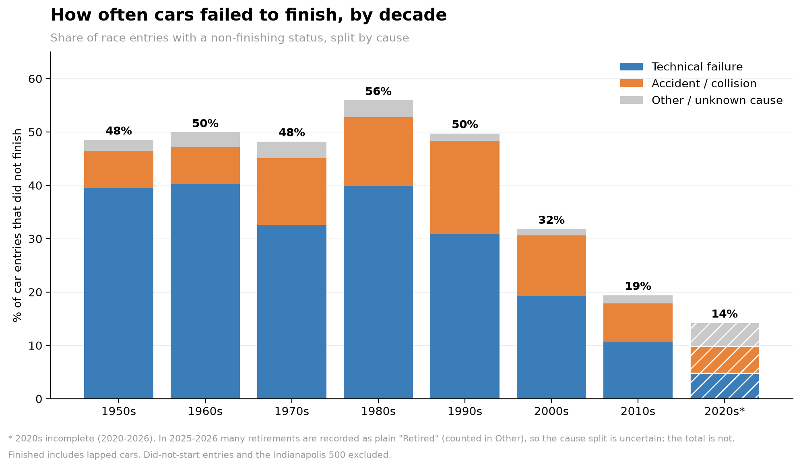
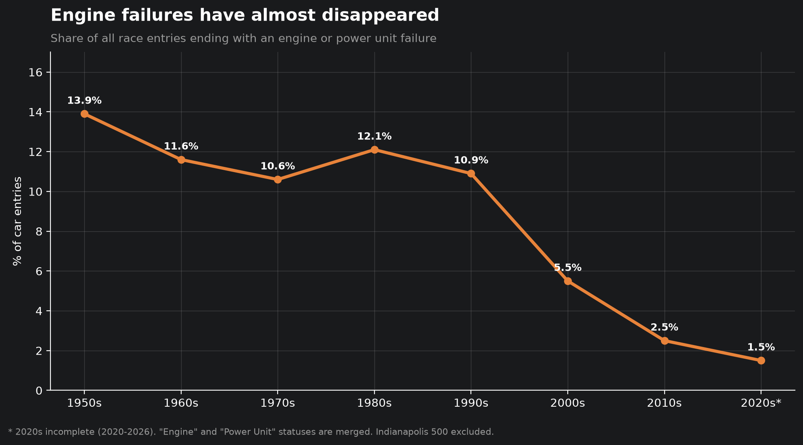

## Q1 Findings

Juan Fangio in the 1950s (47.1% win rate) achieved the highest decade-level win rate in the dataset, narrowly ahead of Michael Schumacher in the 2000s (45.9%) and Max Verstappen in the 2020s (44.4%, decade still incomplete).

The 1980s appear to have been one of the most competitive eras. Alain Prost led the decade with a win rate of only 25.2%, the lowest among all decade leaders, suggesting that victories were shared among several elite drivers.

Lewis Hamilton is the only driver to appear in the top three across three different decades (2000s, 2010s, 2020s).

Win rate favors short, strong careers: Ayrton Senna leads the 1990s with only 67 starts, ahead of Schumacher (128 starts). Small samples can also push newcomers into the top three, such as Andrea Kimi Antonelli in the 2020s (17.1% in 35 starts), which is why a minimum of 20 starts is applied.

### Data Caveat

Starts and wins are counted as distinct races rather than result rows, because in the early seasons drivers sometimes took over a teammate's car mid-race and appear in several rows for the same race.

## Q2 Findings

Ferrari in the 2000s (48.9%), Red Bull in the 2020s (47.9%, decade incomplete) and Mercedes in the 2010s (47.0%) are the most dominant constructor-decades.

The 1970s were the most competitive era: Team Lotus (26.3%) and Ferrari (26.2%) are effectively tied, and Ferrari actually won more races (37 vs 35).

Caveat: the dataset records some teams under several constructor names (e.g. Lotus-Climax and Lotus-Ford in the 1960s), so their results are split across entries, and I deliberately did not merge them because names like "Lotus" and "Renault" refer to unrelated teams in different eras.

## Q3 Findings

Eleven drivers have won three or more titles; Hamilton and Schumacher lead with seven each, followed by Fangio with five.

Nine championships were decided by a single point or less, the closest being Lauda over Prost in 1984 (half a point).

Normalized by the champion's points, the winning margin shows no steady trend but cycles: the 10-year average dips to about 10% in the mid-1980s and around 2008-2010 and recovers to 20%+ in other periods.

The largest margin belongs to Verstappen in 2023 (about 50%).

### Data Caveat

Margins are computed from the final standings in the dataset.

In 1997, Michael Schumacher was excluded from the championship after the Jerez collision, so his points do not appear in the final standings. As a result, Jacques Villeneuve's championship margin appears much larger than the actual title battle.

Point systems and historical scoring rules also changed over time, which is why margins are normalized as a percentage of the champion's points.

## Q4: Pole position advantage

| Decade | Poles | Wins from pole | Win rate | Podium rate |
|---|---|---|---|---|
| 1950s | 76 | 34 | 44.7% | 54.0% |
| 1960s | 99 | 37 | 37.4% | 48.5% |
| 1970s | 144 | 53 | 36.8% | 52.8% |
| 1980s | 156 | 44 | 28.2% | 48.1% |
| 1990s | 162 | 69 | 42.6% | 63.0% |
| 2000s | 174 | 87 | 50.0% | 75.3% |
| 2010s | 198 | 100 | 50.5% | 81.3% |
| 2020s\* | 142 | 80 | 56.3% | 78.9% |

\* 2020s incomplete (2020-2026).

## Q4 Findings

The pole-sitter's win rate fell from 44.7% in the 1950s to a low of 28.2% in the 1980s, then climbed to about 50% in the 2000s and 2010s and to 56.3% in the 2020s (decade still incomplete).

Drivers starting P2-P3 won 15-21% of their races in every decade, so the edge of pole over the next row grew from about 1.7x in the 1980s to about 3.8x in the 2020s.

Winning from the middle of the grid was most common in the 1960s-1980s: P4-P10 starters won 3.5-5.2% of races, compared with roughly 1-2% in the 1950s and since the 1990s. Starters from P11 or lower never won more than 0.33% of races in any decade.

These figures show association, not cause. The fastest car typically takes pole and also wins, so a higher pole win rate may reflect dominant teams (e.g. Mercedes, Red Bull) rather than a stronger effect of the pole position itself.

### Data Caveat

Nine early races (1951-1964) were excluded because several drivers are recorded on grid position 1 (shared cars). A few 1950s races also have shared wins, which can count one race win twice in the grid-group table. `grid` is the starting grid, which can differ from the qualifying result because of grid penalties. Pit-lane starts (`grid = 0`) are excluded. - The Indianapolis 500 counted as a World Championship round from 1950 to 1960 and is part of the dataset. Its 33-car grid skews "back of the grid" statistics in the 1950s; for example, all three 1950s wins from 11th or lower came at Indianapolis.

## Q5: Position gainers

### Findings

A naive ranking by positions gained (grid minus finish) is dominated by midfield and backmarker drivers of the 1970s-1990s, such as Marc Surer (+8.3 per race), because they start far back and survive the attrition of their era, while front-runners have little room to gain.

Comparing each driver with the typical finish from the same grid slot in the same decade gives a very different top ten. Max Verstappen leads at +1.69 positions per race (211 classified finishes), ahead of Niki Lauda and Bruce McLaren (+1.26 each). The top ten consists almost entirely of champions and drivers of front-running teams, so this metric partly reflects car quality, not only overtaking skill.

### Data Caveat

Only classified finishers are counted, so the metric ignores retirements. The Indianapolis 500 and 9 races with ambiguous grid data are excluded. A driver needs at least 50 classified finishes, and grid slots with fewer than 20 finishers per decade are ignored.

## Q6: Pit lane time since 2011

### Findings

Pit stop data exists only from 2011, so this question covers 2011-2026 rather than the full history. The median time spent in the pit lane has not shortened: it stayed around 22.3-22.9 s in 2011-2013 and between 23.1 and 24.6 s since 2014.

Means are misleading here. In 2021 the mean pit lane time was 220 s against a median of 24.3 s, because 13.8% of stops lasted more than a minute (red flags, repairs). The same happened in 2020, 2022, 2023 and 2024, which is why the median is used.

Comparing the same circuits in 2011-2014 and 2022-2025 removes the effect of calendar changes. At 12 of 16 circuits the median changed by less than about 1.1 s: 11 circuits are slightly slower, 5 slightly faster. Two circuits stand out, and in both cases the change is a step in a single season rather than a gradual trend. At Albert Park the median fell from 22-24 s (2011-2019) to about 18 s from 2022; at Silverstone it rose from about 25 s (2011-2013) to about 29 s from 2014. This points to changes at the circuits rather than to team performance, although the data does not show the cause.

### Data Caveat

`duration` measures the whole time in the pit lane (entry to exit), not the stationary time of the tire change. Stops under 10 s (29 records, 28 of them in the newly added 2026 season) are excluded as data errors. 2026 is incomplete and 2020 was a shortened season. Red-flag stops can last many minutes and dominate single races: at Albert Park 2023, 49 of 65 stops lasted over a minute, which distorts even the median for that race.

## Q7: Reliability

### Findings

Until the 1990s about half of all car entries failed to finish (48-50% in the 1950s-1970s), peaking at 55.9% in the 1980s. The rate then fell steadily: 31.8% in the 2000s, 19.4% in the 2010s and 14.2% in the 2020s (decade incomplete).

Technical failures drove most of that decline, from about 40% of entries in the 1950s, 1960s and 1980s to 10.7% in the 2010s and 4.8% in the 2020s. The engine was the single most common cause of retirement in every decade up to the 2000s (13.9% of entries in the 1950s, 5.5% in the 2000s) and fell to 2.5% in the 2010s and 1.5% in the 2020s. Since the 2010s collisions are the most common cause of retirement (4.0% of entries).

Accidents peaked in the 1990s at 17.4% of entries (9.8% of them "spun off") and have fallen since.

### Data Caveat

Reliability is measured as the share of car entries that did not end with a "Finished" status (finished or lapped); entries that never started (did not qualify, withdrew) and the Indianapolis 500 are excluded. Entries are result rows, so a shared car in the 1950s counts as two entries.

Causes were grouped manually from the status table (Technical, Accident, Other). "Other" contains unknown causes (Retired, Not classified), disqualifications and driver-related reasons, so it says nothing about car reliability.

In 2025-2026 many retirements are recorded as plain "Retired" without a cause (95 entries, about 3 percentage points of all 2020s entries). The 2020s total failure rate is unaffected, but the technical/accident split for that decade is uncertain, and the true technical share is probably higher than 4.8%.